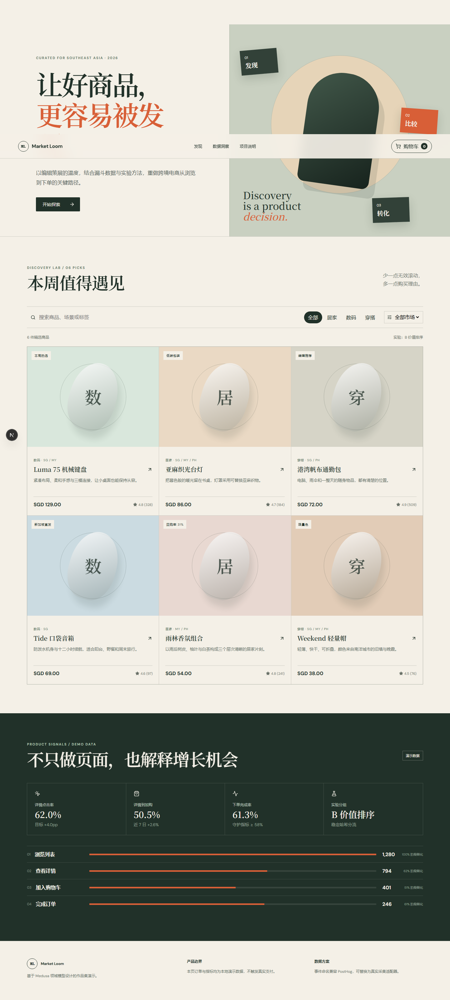

# Commerce Insight / Market Loom

面向东南亚跨境电商场景的商品发现与转化优化作品集。项目围绕“发现 → 详情 → 加购 → 结算 → 订单”实现完整可交互闭环，并把漏斗指标、埋点口径和 A/B 实验放进同一套产品叙事。

> 本项目采用 Medusa 兼容的后端适配边界和 PostHog 兼容事件命名。默认是无需数据库、密钥或支付信息的离线演示，归属与边界见 [UPSTREAM.md](UPSTREAM.md)。



## 已实现

- 中文搜索、分类与新加坡/马来西亚/菲律宾市场筛选
- 策展型商品卡、详情弹层、购物车、免运费规则和模拟订单
- 价格全程使用整数分计算，避免浮点误差
- 稳定哈希 A/B 分流与演示漏斗看板
- 五类商品与交易事件，可替换为 PostHog 采集器
- `CommerceBackend` 接口，可替换为 Medusa Store API 适配器
- 响应式桌面/移动界面、单元测试、类型检查、生产构建和 CI

## 本地运行

```bash
pnpm install
pnpm dev
```

访问 <http://localhost:3000>。演示模式不需要 `.env`；生产接入变量示例见 `.env.example`。

```bash
pnpm test
pnpm typecheck
pnpm build
```

## 产品材料

- [PRD](docs/PRD.md)
- [指标与埋点](docs/METRICS.md)
- [用户研究执行模板](docs/USER_RESEARCH_TEMPLATE.md)
- [设计说明](docs/superpowers/specs/2026-10-23-commerce-insight-design.md)

## 诚实边界

界面中的订单、漏斗、评价和实验结果均为演示数据。用户研究文件是执行模板，不代表已经访谈真实用户。接入生产环境前还需要服务端购物车、库存校验、支付回调、税费服务、身份认证、隐私同意与数据保留策略。

---

## English

Commerce Insight (Market Loom) is a Medusa-compatible, PostHog-ready commerce portfolio project for Southeast Asian product discovery. It includes a complete local demo journey, typed domain logic, deterministic experiment assignment, funnel definitions, responsive UI, tests, and product documentation.

Run `pnpm install && pnpm dev`. No credentials are required for demo mode. Production metrics and user research are never implied; all checked-in figures are explicitly simulated.
